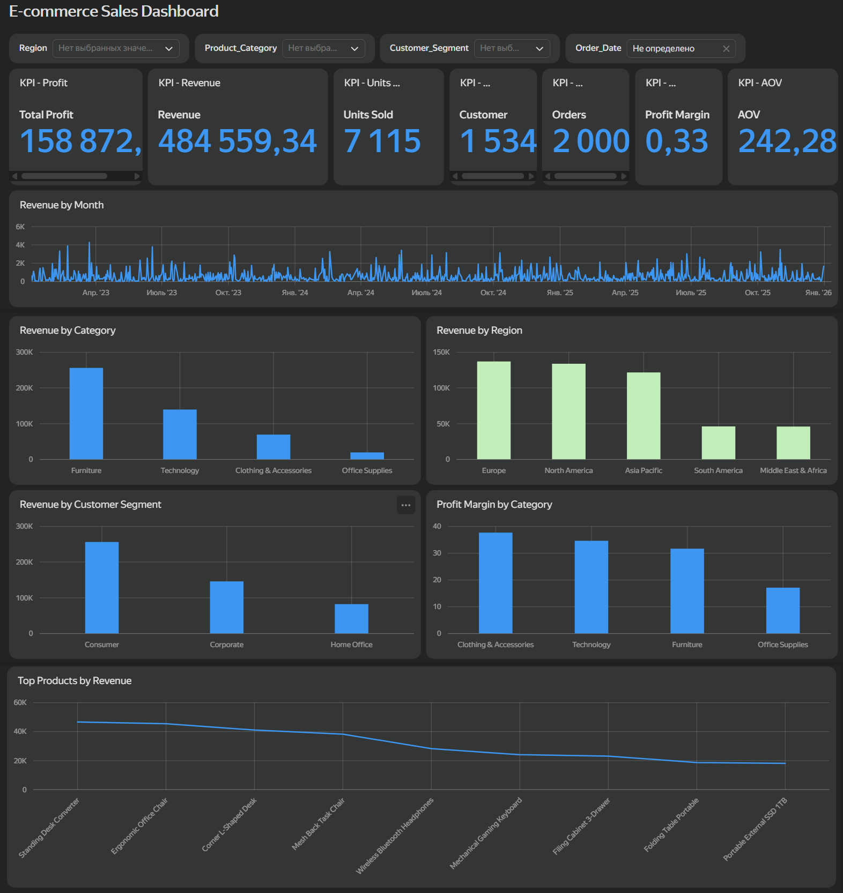

# Портфолио аналитика данных

Учебные проекты по Python, PostgreSQL, статистике и Yandex DataLens. Основной кейс — анализ заказов интернет-магазина; отдельно представлены A/B-тестирование и SQL-модель с несколькими таблицами.

## E-commerce: от CSV до дашборда

Один набор из **2 000 учебных заказов за 2023–2025 годы** разобран несколькими способами:

- [Python / Pandas](01_sales_analysis/) — проверка данных, выручка, прибыль, средний чек и разрезы по категориям;
- [SQL / PostgreSQL](03_sql_analysis/) — группировки, CTE, оконные функции, динамика продаж;
- [Yandex DataLens](05_dashboard/) — KPI и графики по тем же данным;
- [Итоговый анализ](06_final_project/) — выводы о категориях, регионах и маржинальности.

| Показатель по учебному CSV | Значение |
|---|---:|
| Заказы | 2 000 |
| Выручка | 484 559,34 |
| Прибыль (поле источника) | 158 872,32 |
| Маржинальность | 32,79% |
| Средний чек | 242,28 |

[Как рассчитываются показатели](01_sales_analysis/README.md) · [О происхождении данных](01_sales_analysis/data/README.md)

## Другие проекты

**[A/B-тест Cookie Cats](02_ab_testing/)** — сравнение удержания игроков на 1-й и 7-й день. Использованы критерий χ² и доверительные интервалы. На 7-й день разница между вариантами составила −0,82 процентного пункта (p ≈ 0,0016).

**[Marketing Analytics](04_marketing_analysis/)** — расчёт CTR, CPC и группировка 1 000 **синтетических** записей о рекламных кампаниях. Показатели не являются историей реального рекламного кабинета.

**[Relational SQL Case](07_relational_sql_case/)** — отдельная учебная база PostgreSQL из пяти связанных таблиц: customers, products, orders, order_items, payments. В запросах используются JOIN, CASE, CTE и оконные функции.

## Инструменты

- **Python:** Pandas, NumPy, SciPy, Statsmodels;
- **SQL:** PostgreSQL, группировки, JOIN, CTE, оконные функции;
- **BI:** Yandex DataLens, вычисляемые показатели и фильтры;
- **Методы:** проверка качества данных, KPI, группировка, анализ экспериментов.

## Как проверять результаты

Код, исходные CSV и формулы лежат в соответствующих папках. Для Python-проектов предусмотрена [автоматическая проверка GitHub Actions](.github/workflows/portfolio-qa.yml); [последние запуски](https://github.com/ONN9IX/analyst-portfolio/actions) доступны публично.

Наборы для e-commerce и маркетинга используются **как учебные**, а не как доказательство продаж или маркетинговых результатов конкретной компании. Четыре e-commerce раздела работают с одним и тем же CSV и не представляют четыре независимых бизнес-проекта.
